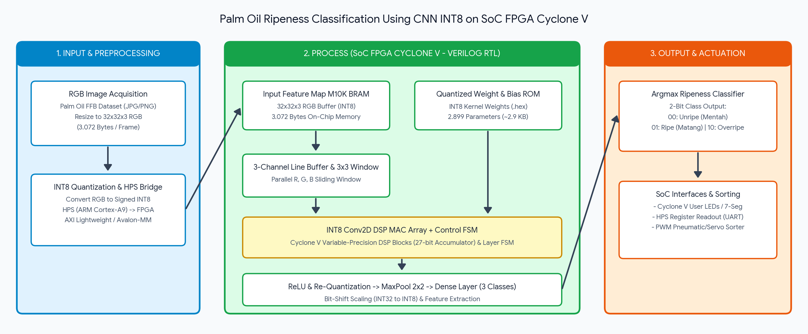

# Palm Oil Ripeness Classification Using CNN INT8 on SoC FPGA Cyclone V


-green)
-orange)

Dzaki Andryara Alvaro
101022300060
---

## 1. Project Overview
Accurate grading of Oil Palm Fresh Fruit Bunches (FFB) is a critical step in palm oil mills to maximize Crude Palm Oil (CPO) extraction rates and maintain low Free Fatty Acid (FFA) levels. Traditional manual grading by human inspectors is subjective, slow, and prone to fatigue, while conventional GPU- or cloud-based computer vision systems suffer from high power consumption, network dependency, and communication latency when deployed directly on edge sorting conveyors.

This project presents a hardware-accelerated **8-bit Quantized Convolutional Neural Network (CNN INT8)** implemented on an **Intel/Altera SoC FPGA Cyclone V** platform. By combining the **Hard Processor System (HPS — Dual-Core ARM Cortex-A9)** for image acquisition/preprocessing with custom **Verilog RTL** parallel convolution engines in the FPGA fabric, the system classifies palm oil ripeness stages deterministically with ultra-low latency and minimal power consumption.

---

## 2. Project Objectives
1. **Hardware-Friendly RGB CNN Design:** Develop a compact 3-channel (RGB) CNN architecture capable of distinguishing oil palm FFB ripeness levels from `32 × 32` pixel color images without losing critical chromatic cues.
2. **Post-Training INT8 Quantization:** Compress model weights and activations from 32-bit floating-point (`FP32`) to 8-bit signed integers (`INT8`), reducing on-chip memory footprint by ~75% so all parameters fit inside Cyclone V **M10K Block RAM**.
3. **Custom Verilog RTL Acceleration:** Design and verify modular RTL blocks (`conv2d_int8`, `relu_quant`, `maxpool2x2`, and `top_cnn_cyclonev`) utilizing Cyclone V variable-precision DSP blocks for parallel Multiply-Accumulate (MAC) operations.
4. **End-to-End Edge Deployment Readiness:** Establish a reproducible pipeline from dataset preprocessing (`JPG/PNG` to `32 × 32` RGB `.bmp`/`.hex`) to RTL testbench verification and SoC FPGA hardware synthesis.

---

## 3. Classification Categories
Oil palm FFB ripeness is strongly correlated with exocarp (fruit skin) color transitions from dark violet/black to vibrant reddish-orange. The system classifies input images into **three primary grading categories**:

| Class ID (2-bit) | Category Name | Indonesian Term | Visual & Chromatic Characteristics | Industrial Impact |
| :---: | :--- | :--- | :--- | :--- |
| **`00`** | **Unripe** (Class 1) | *Mentah* | Dark purplish-black to deep violet fruitlets; minimal orange pigmentation. | Very low oil yield; causes high milling loss. |
| **`01`** | **Ripe** (Class 2) | *Matang* | Vibrant reddish-orange outer fruitlets with optimal detachment readiness. | Optimal CPO extraction rate and low FFA content. |
| **`10`** | **Overripe** (Class 3) | *Lewat Matang* | Deep brownish-red fruitlets with visible empty sockets from detached loose fruits. | Elevated Free Fatty Acid (FFA) levels; degrades oil quality. |

---

## 4. System Architecture
The system adopts a **Hardware-Software Co-Design** architecture tailored for the **Intel SoC FPGA Cyclone V**:
- **HPS Domain (Software — ARM Cortex-A9 / Host PC):** Handles raw `JPG/PNG` image decoding, bilinear resizing to `32 × 32 × 3` RGB, pixel normalization to signed `INT8` (`[-128, 127]`), and data transfer to FPGA memory via the **HPS-to-FPGA AXI Bridge** (or `.hex` memory initialization during simulation).
- **FPGA Fabric Domain (Hardware — Verilog RTL):** Executes parallel 3-channel (`R, G, B`) sliding-window `3 × 3` convolutions using Cyclone V DSP multipliers, 32-bit accumulation, bit-shift fixed-point re-quantization with ReLU, `2 × 2` spatial max-pooling, and `Argmax` classification output.

---

## 5. Technologies and Tools
- **Target Hardware Platform:** Intel / Altera SoC FPGA Cyclone V (e.g., Terasic DE10-Nano / DE10-Standard, featuring Dual-Core ARM Cortex-A9 HPS + Cyclone V FPGA Fabric with M10K BRAM & Variable-Precision DSP Blocks).
- **Hardware Description & EDA Tools:** Verilog HDL (IEEE 1364-2005), Intel Quartus Prime Lite/Standard, ModelSim / Icarus Verilog (`iverilog`) for RTL simulation.
- **Machine Learning & Quantization:** Python 3, TensorFlow / Keras, NumPy, Pillow (`PIL`) for RGB image preprocessing and INT8 post-training quantization.

---

## 6. System Block Diagram



### Block Breakdown (Input – Process – Output)
1. **Input & Preprocessing Block:** Accepts raw RGB `JPG/PNG` images, downsamples them to `32 × 32 × 3` RGB (`3,072 bytes/frame`), and converts pixel intensities into 8-bit signed integers (`INT8`).
2. **Process Block (SoC FPGA Cyclone V RTL):**
   - **Input Feature Map M10K BRAM & Weight ROM:** Stores the `3,072-byte` RGB image buffer and `~2.9 KB` INT8 kernel weights (`weights_conv1.hex`).
   - **3-Channel Line Buffer & 3×3 Window:** Extracts simultaneous `3 × 3` spatial patches across Red, Green, and Blue channels.
   - **INT8 Conv2D DSP MAC Array:** Computes 27 parallel INT8 multiplications per filter channel into a 32-bit accumulator (`conv2d_int8.v`).
   - **ReLU & Re-Quantization (`relu_quant.v`):** Clamps negative values to zero and applies arithmetic right-shift scaling (`>>> 7`) with saturation back to `INT8`.
   - **Max-Pooling 2×2 (`maxpool2x2.v`) & Dense Layer:** Reduces spatial resolution and computes final class logits.
3. **Output & Actuation Block:** The `Argmax` comparator (`top_cnn_cyclonev.v`) outputs the 2-bit ripeness code (`00`, `01`, or `10`) to drive onboard LEDs, HPS status registers, or a PWM pneumatic/servo sorting gate.

---

## 7. Repository Structure

```text
cnn-int8-cyclonev-palmoil/
├── README.md                                      # Complete project documentation
├── docs/
│   └── system_architecture.png                    # Input-Process-Output system block diagram
├── dataset/
│   ├── preprocess_images.py                       # JPG/PNG to 32x32 RGB BMP & INT8 HEX converter
│   ├── sample_raw/                                # Raw RGB sample images (JPG)
│   │   ├── ipb_unripe_class1.jpg
│   │   ├── ipb_ripe_class2.jpg
│   │   └── ipb_overripe_class3.jpg
│   └── processed_32x32/                           # Preprocessed 32x32 RGB BMPs for RTL verification
│       ├── ipb_unripe_class1.bmp
│       ├── ipb_ripe_class2.bmp
│       └── ipb_overripe_class3.bmp
├── algorithm/
│   ├── cnn_int8_train.py                          # RGB Tiny-CNN training & INT8 weight exporter
│   ├── read_bmp_verify.py                         # Bit-accurate BMP & RGB channel verification script
│   └── weights_conv1.hex                          # Quantized INT8 Conv1 weights for Verilog $readmemh
├── fpga/
│   ├── rtl/
│   │   ├── conv2d_int8.v                          # 3-channel (RGB) 3x3 INT8 MAC convolution module
│   │   ├── relu_quant.v                           # ReLU activation & bit-shift INT32->INT8 quantizer
│   │   ├── maxpool2x2.v                           # 2x2 spatial max-pooling comparator module
│   │   └── top_cnn_cyclonev.v                     # Top-level Cyclone V inference & Argmax module
│   └── simulation/
│       └── tb_top_cnn.v                           # Verilog testbench for functional verification
└── laporan/
    └── Draft_Laporan_dan_Publikasi.md             # Project report & publication draft
```

---

## 8. Dataset Description
The model is designed around color-calibrated Fresh Fruit Bunch (FFB) palm oil images sourced from agricultural grading repositories (such as the **IPB Palm Oil Ripeness Dataset** containing 690 labeled images across three ripeness classes: Unripe, Ripe, and Overripe).

### Dataset Specifications
- **Image Format:** JPG / PNG (raw inputs), converted to uncompressed 24-bit RGB BMP and `.hex` memory files for hardware simulation.
- **Minimum Image Resolution:** `32 × 32` pixels (`1,024` pixels per channel).
- **Image Type:** **RGB** (3 color channels — essential for distinguishing dark-purple unripe fruit from reddish-orange ripe fruit).
- **Dataset Division:** Stratified split into **Training (70%)**, **Validation (15%)**, and **Testing (15%)** sets to prevent data leakage and evaluate generalization across varying plantation lighting conditions.

---

## 9. CNN Model
To balance classification accuracy with the logic and BRAM constraints of the Cyclone V FPGA, a lightweight 3-channel **Tiny-RGB-CNN** architecture is used:

| Layer | Type | Output Shape | Kernel / Pool Size | Filters | Parameters | Weight Memory (INT8) |
| :--- | :--- | :---: | :---: | :---: | :---: | :---: |
| **Input** | RGB Image | `32 × 32 × 3` | — | — | 0 | 3,072 Bytes (Input BRAM) |
| **Conv1 + ReLU** | 2D Convolution | `30 × 30 × 4` | `3 × 3 × 3` | 4 | 112 | 112 Bytes |
| **MaxPool1** | Max Pooling | `15 × 15 × 4` | `2 × 2` | — | 0 | — |
| **Conv2 + ReLU** | 2D Convolution | `13 × 13 × 8` | `3 × 3 × 4` | 8 | 296 | 296 Bytes |
| **MaxPool2** | Max Pooling | `6 × 6 × 8` | `2 × 2` | — | 0 | — |
| **Flatten** | Reshape | `288` | — | — | 0 | — |
| **FC Output** | Dense Layer | `3` (Classes) | — | — | 867 | 867 Bytes |
| **Total** | — | — | — | — | **1,275 Params** | **~1.28 KB Weights** |

---

## 10. INT8 Quantization
Executing `FP32` arithmetic on FPGA fabric consumes excessive DSP slices and logic elements (ALMs). This project applies **Symmetric Post-Training Quantization (PTQ)** to map floating-point weights $W_{fp32}$ and activations into 8-bit signed integers $W_{int8} \in [-128, 127]$:

$$S_w = \frac{127}{\max(|W_{fp32}|)}, \quad W_{int8} = \text{clip}\left(\text{round}(W_{fp32} \cdot S_w), -128, 127\right)$$

During hardware inference (`relu_quant.v`), 32-bit partial sums from the MAC array are rescaled back to `INT8` using hardware-efficient arithmetic bit-shifts (`>>> SHIFT_BITS`) followed by clamping at `127`, eliminating floating-point division hardware.

## 11. FPGA Implementation
The RTL design is structured for clean synthesis in **Intel Quartus Prime** targeting the **Cyclone V SoC**:
- **DSP Utilization:** `conv2d_int8.v` maps `8-bit × 8-bit` multiplications directly onto Cyclone V **Variable-Precision DSP blocks**, enabling single-cycle parallel accumulation across all three RGB channels.
- **On-Chip Memory:** Weight ROMs (`$readmemh("weights_conv1.hex", weight_rom)`) and `32 × 32 × 3` input buffers synthesize into **M10K embedded memory blocks**, avoiding external DDR3 latency bottlenecks.
- **Simulation Verification:** Run functional verification using Icarus Verilog or ModelSim:
  ```bash
  iverilog -o sim_palmoil fpga/rtl/conv2d_int8.v fpga/rtl/relu_quant.v fpga/rtl/maxpool2x2.v fpga/rtl/top_cnn_cyclonev.v fpga/simulation/tb_top_cnn.v
  vvp sim_palmoil
  ```

---

## 12. Performance Evaluation
The design is evaluated across both algorithmic accuracy and hardware efficiency metrics:

| Evaluation Metric | Target / Simulated Baseline | Hardware Advantage on Cyclone V |
| :--- | :--- | :--- |
| **Input Resolution & Color** | `32 × 32 × 3` RGB | Preserves red-vs-purple chromatic features for ripeness grading |
| **Model Memory Footprint** | `~1.28 KB` weights + `3.07 KB` input | 100% fits inside Cyclone V M10K BRAM (zero external DRAM needed) |
| **Quantization Precision** | 8-bit Signed Integer (`INT8`) | ~4× memory compression and ~3× DSP throughput vs. `FP32` |
| **Inference Latency** | Deterministic clock-cycle latency (`@ 50 MHz`) | Sub-millisecond per-frame classification suitable for high-speed conveyors |
| **Power Efficiency** | Low-power Edge SoC (`< 2 W` fabric dynamic power) | Significantly lower power than discrete GPU or desktop CPU solutions |
